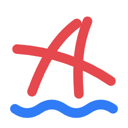

<div align="center">
  
</div>

<h1 align="center">XG-AIGC</h1>

<p align="center">
  <a href="https://xiexiage.com"></a>
  <a href="https://github.com/XXGGG"></a>
</p>

<p align="center">學習 AI 影片的開源資料站：提示詞、參考圖、三視圖、運鏡和案例，全部公開，免費使用。</p>

<p align="center">
  <a href="https://xgai.xiexiage.com"><b>線上使用 xgai.xiexiage.com</b></a>
</p>

<p align="center">
  <a href="README.md">官话 - 简体中文</a> | 官話 - 繁體中文 | <a href="README-jyut.md">廣東話</a> | <a href="README-en.md">English</a>
</p>

<p align="center">
  
  
  
  
</p>

<p align="center"></p>

## 這是什麼

我也是從零開始學 AI 影片的，受過很多前輩無私分享的幫助，所以把自己用過的提示詞、參考圖和做法都攤開來，做成當初自己最需要的地方。沒有訂閱、付費和廣告。

| 頁面 | 能做什麼 |
| --- | --- |
| **更衣室** | 點選人種、年齡、髮型、飾品、衣服和鞋子，拼出一段完整的人物三視圖提示詞；每個部件都有參考圖，每張圖的提示詞都能複製。 |
| **場景** | 橫屏場景圖和提示詞，按系列（後室、仙境、賽博朋克……）和標籤篩選，拿來當背景或第一格畫面。 |
| **三視圖** | 現成的人物三視圖（大頭照 + 正面全身 + 背面全身），站長生成的可以直接下載原圖。 |
| **提示詞** | 動漫 2D 化、Q 版、建模 3D 化、轉真人、換衣服等圖生圖提示詞，每組都有原圖和效果對比。 |
| **運鏡 · 鏡頭** | 幾十種運鏡和鏡頭語言，每種配一段演示影片和可複製的提示詞。 |
| **案例** | 完整作品拆解：每個片段用的模型、解析度、時長、參考圖和原始提示詞。 |

介面支援簡體中文、繁體中文、English、日本語、한국어。

## 截圖

| 更衣室 | 場景 |
| --- | --- |
|  |  |
| **三視圖** | **提示詞** |
|  |  |
| **運鏡 · 鏡頭** | **案例** |
|  |  |

## 怎麼用

1. 開啟 [xgai.xiexiage.com](https://xgai.xiexiage.com)，不用註冊。
2. **做人物**：進「更衣室」，在左欄依次選人物、髮型、飾品、上裝、下裝、鞋子。右邊會實時顯示對應的參考圖，右下角開啟提示詞，點「複製」。
3. 把提示詞貼進你常用的生圖工具（Krea 2、Z-Image、即夢、GPT-image 等）生成三視圖，再拿三視圖去做影片。
4. **找背景**：進「場景」挑一張，複製提示詞自己生成，或直接拿圖當參考。
5. **學鏡頭**：進「運鏡 · 鏡頭」看演示影片，把運鏡提示詞接在你的影片提示詞後面。
6. **看別人怎麼做**：進「案例」，按片段看每一段用了什麼參考圖和提示詞。

<p align="center"></p>

<p align="center"></p>

## 本地執行

需要 Node.js 20.19 以上。

```bash
git clone https://github.com/XXGGG/XG-AIGC.git
cd XG-AIGC
npm install
npm run dev      # 开发预览，局域网也能访问
npm run build    # 打包到 dist/，可以直接放到任何静态托管
```

## 目錄

```
src/
  components/   页面和组件（TopBar、SidePanel、StagePanel、LibSplit、CasePage……）
  data/         条目数据：人物、发型、服装、鞋子、场景、运镜、案例
  lib/          提示词生成、状态、图片查找
  i18n/         五种语言的界面文字
public/
  images/       局部参考图（images/<模型>/<f|m|u>/<分类>/<id>__<颜色>.webp）
  cases/ camera/ sheets/   案例片段、运镜演示、三视图原图
tools/          图片同步和翻译辅助脚本
```

## 授權

- **程式碼**：[MIT](LICENSE)。
- **提示詞和網站文字**：CC0 1.0，商用、修改都可以，不用署名。
- **站長生成的圖和影片**（更衣室、場景、三視圖頁「站長生成」、運鏡演示）：CC0 1.0。
- **例外**：三視圖頁「網路熱門」和提示詞頁部分示例圖，是 AI 產品、遊戲角色的擬人或同人改編，角色歸原作者和原公司，不是 CC0，每張都寫了出處和協議，請照著用。案例頁的影片片段只供線上觀看。
- 所有圖片都由 AI 生成，人物是虛構的。請遵守當地法律，釋出時按規定標明 AI 生成。詳見網站「關於」頁。

如果覺得哪張圖侵犯了你的權利，請提 [Issue](https://github.com/XXGGG/XG-AIGC/issues)，核實後會儘快撤下。
