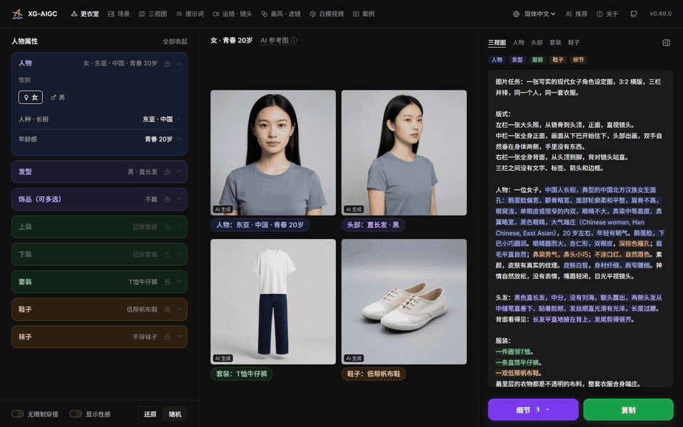
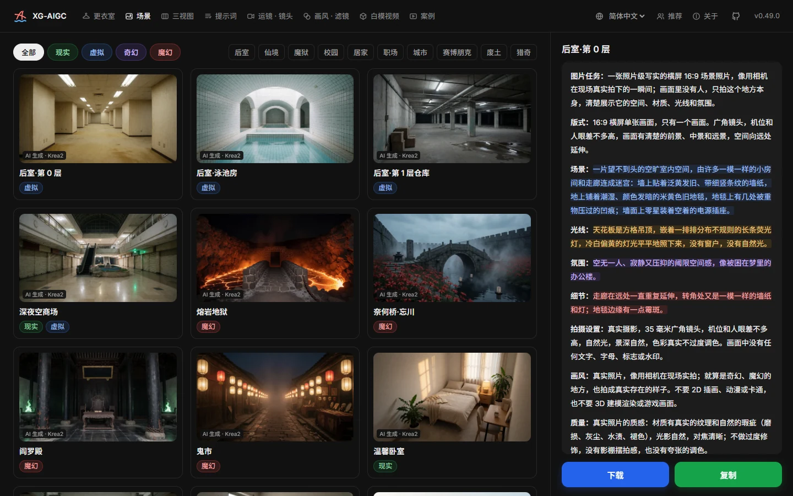
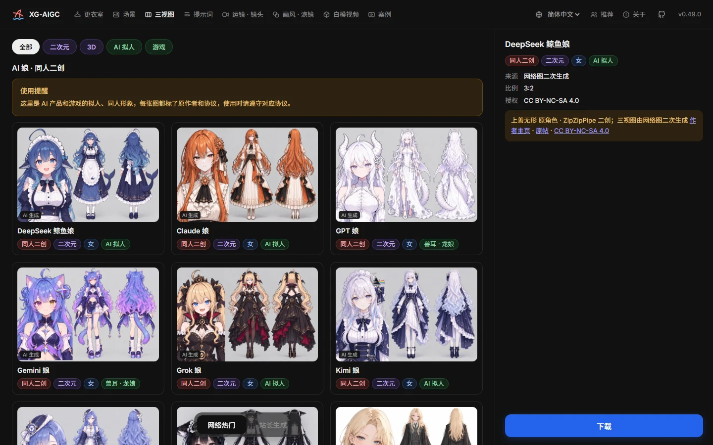
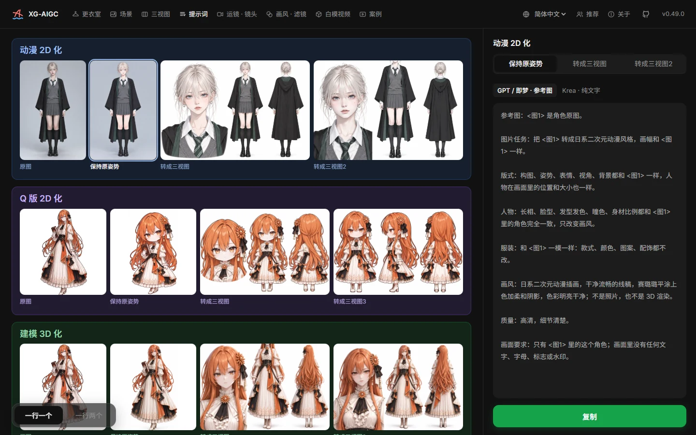
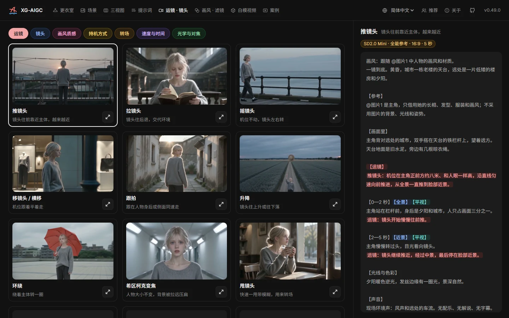
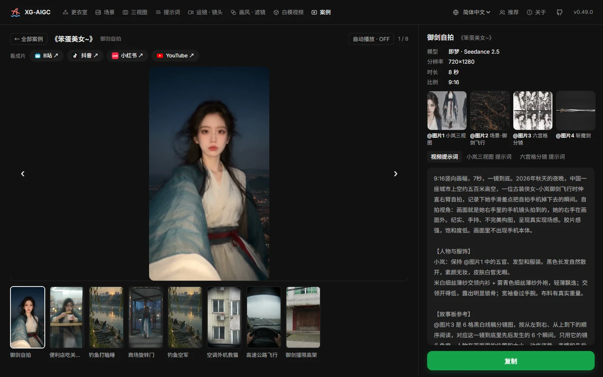
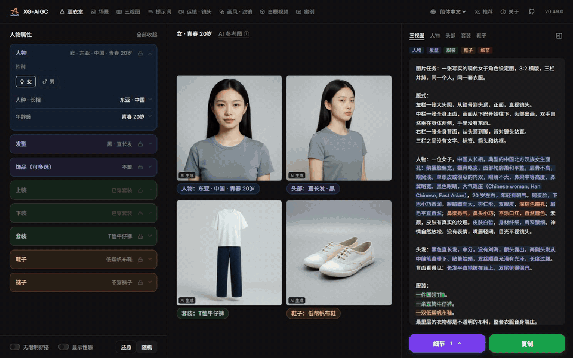
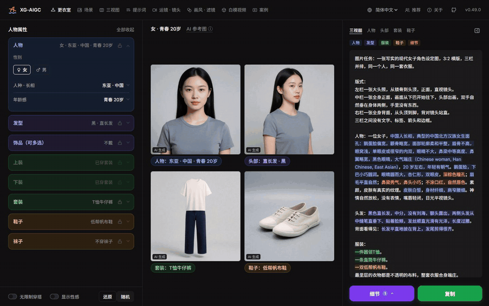

<p align="center">
  
</p>

<h1 align="center">XG-AIGC</h1>

<p align="center">學 AI 影片嘅開源資料站：提示詞、參考圖、三視圖、運鏡同案例，全部公開，免費任用。</p>

<p align="center">
  <a href="https://xgai.xiexiage.com"><b>網上即用 xgai.xiexiage.com</b></a>
</p>

<p align="center">
  <a href="README.md">English</a> | <a href="README-cmn_CN.md">官话 - 简体中文</a> | <a href="README-cmn_TW.md">官話 - 繁體中文</a> | 廣東話
</p>

<p align="center">
  
  
  
  
</p>

<p align="center"></p>

## 呢個係咩

我都係由零開始學 AI 影片，得到好多前輩無私分享幫手，所以將自己用開嘅提示詞、參考圖同做法全部攤開，整成當初自己最需要嗰個地方。冇訂閱、冇收費、冇廣告。

| 頁面 | 做到啲咩 |
| --- | --- |
| **更衣室** | 揀人種、年齡、髮型、飾物、衫褲同鞋，砌出一段完整嘅人物三視圖提示詞；每個部件都有參考圖，每張圖嘅提示詞都可以複製。 |
| **場景** | 橫向場景圖同提示詞，可以按系列（後室、仙境、賽博朋克……）同標籤篩選，用嚟做背景或者第一格畫面。 |
| **三視圖** | 現成嘅人物三視圖（大頭相 + 正面全身 + 背面全身），站長自己生成嗰啲可以直接下載原圖。 |
| **提示詞** | 動漫 2D 化、Q 版、3D 建模、轉真人、換衫等圖生圖提示詞，每組都有原圖同效果對比。 |
| **運鏡 · 鏡頭** | 幾十種運鏡同鏡頭語言，每種都有一段示範片同可以複製嘅提示詞。 |
| **案例** | 完整作品拆解：每段片用咗咩模型、解像度、長度、參考圖同原始提示詞。 |

介面有簡體中文、繁體中文、English、日本語、한국어。

## 截圖

| 更衣室 | 場景 |
| --- | --- |
|  |  |
| **三視圖** | **提示詞** |
|  |  |
| **運鏡 · 鏡頭** | **案例** |
|  |  |

## 點樣用

1. 打開 [xgai.xiexiage.com](https://xgai.xiexiage.com)，唔使註冊。
2. **整人物**：入「更衣室」，喺左邊順住揀人物、髮型、飾物、上身、下身、鞋。右邊會即時出返對應嘅參考圖，右下角打開提示詞，㩒「複製」。
3. 將提示詞貼落你慣用嘅生圖工具（Krea 2、Z-Image、即夢、GPT-image 等）生成三視圖，再攞三視圖去整片。
4. **搵背景**：入「場景」揀一張，複製提示詞自己生成，或者直接攞張圖做參考。
5. **學鏡頭**：入「運鏡 · 鏡頭」睇示範片，將運鏡提示詞駁喺你段影片提示詞後面。
6. **睇人哋點整**：入「案例」，逐段睇每段片用咗咩參考圖同提示詞。

<p align="center"></p>

<p align="center"></p>

## 喺自己部機度行

要 Node.js 20.19 或以上。

```bash
git clone https://github.com/XXGGG/XG-AIGC.git
cd XG-AIGC
npm install
npm run dev      # 開發預覽，同一個網絡嘅機都睇到
npm run build    # 打包去 dist/，放上任何靜態寄存都得
```

## 目錄

```
src/
  components/   頁面同組件（TopBar、SidePanel、StagePanel、LibSplit、CasePage……）
  data/         條目資料：人物、髮型、衫褲、鞋、場景、運鏡、案例
  lib/          提示詞生成、狀態、搵圖
  i18n/         五種語言嘅介面文字
public/
  images/       局部參考圖（images/<模型>/<f|m|u>/<分類>/<id>__<顏色>.webp）
  cases/ camera/ sheets/   案例片段、運鏡示範、三視圖原圖
tools/          同步圖片同翻譯輔助嘅腳本
```

## 授權

- **程式碼**：[MIT](LICENSE)。
- **提示詞同網站文字**：CC0 1.0，商用、改都得，唔使署名。
- **站長生成嘅圖同片**（更衣室、場景、三視圖頁「站長生成」、運鏡示範）：CC0 1.0。
- **例外**：三視圖頁「網路熱門」同提示詞頁部分示例圖，係 AI 產品、遊戲角色嘅擬人或者同人改編，角色屬於原作者同原公司，唔係 CC0，每張都寫咗出處同協議，請跟住用。案例頁嘅片段只可以喺網站度睇。
- 所有圖都係 AI 生成，人物係虛構。請遵守當地法律，發佈時按規定註明 AI 生成。詳情睇網站「關於」頁。

如果覺得邊張圖侵犯咗你嘅權利，請開 [Issue](https://github.com/XXGGG/XG-AIGC/issues)，核實之後會盡快落架。
